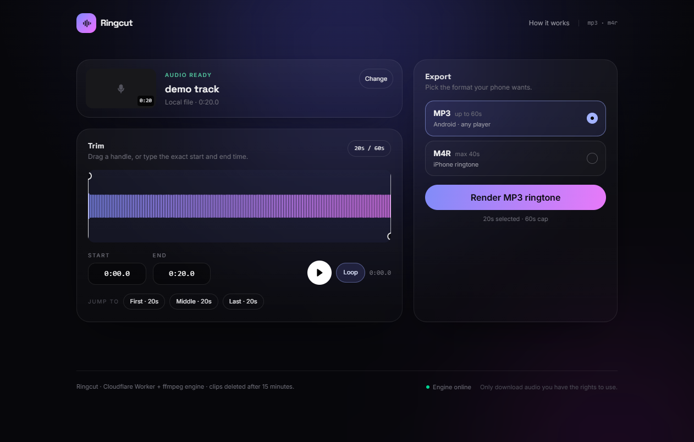
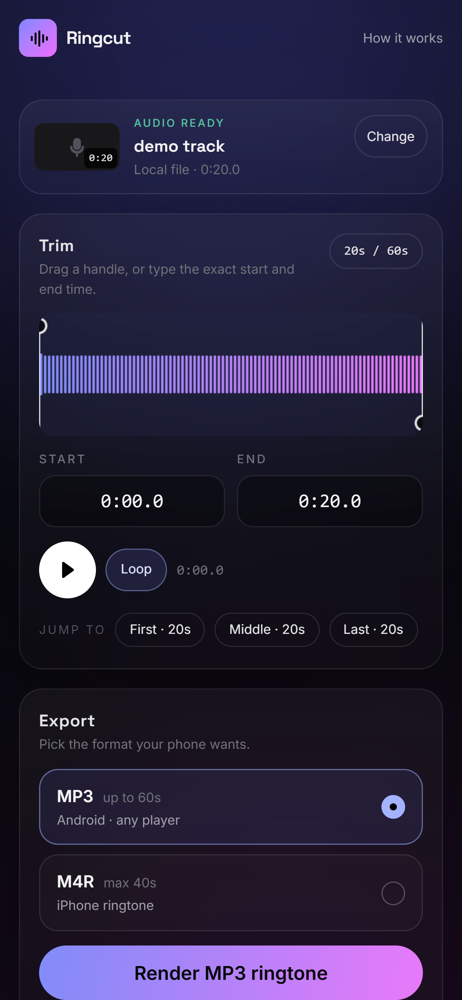
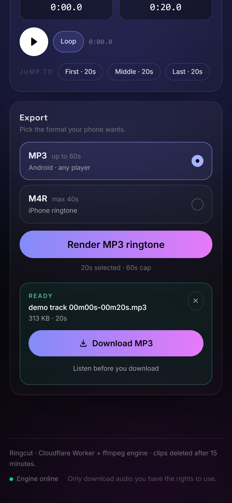

# Ringcut — YouTube → Ringtone (MP3 / M4R)

Paste a YouTube link, drag out the exact seconds you want, download an **MP3** for Android or an
**M4R** for iPhone. No app, no account, no watermark.

- **Frontend:** React 19 + Vite + Tailwind v4 (mobile-first, installable-looking, no UI kit)
- **API:** Cloudflare Worker running **Hono** (tiny router, full CORS, streaming passthrough)
- **Engine:** a small Node service that owns the two things a Worker cannot run — `yt-dlp` and `ffmpeg`



| Phone — editor | Phone — result |
| --- | --- |
|  |  |

---

## Why there is a separate engine

Cloudflare Workers cannot spawn processes, so `yt-dlp` + `ffmpeg` cannot run there. Ringcut splits the
work honestly:

```
Browser ──▶ Worker (Hono)  ──▶  Engine (Node + yt-dlp + ffmpeg)
            · validation          · download audio
            · CORS + rate limit   · normalise to AAC/M4A
            · static SPA          · waveform peaks
            · byte relay          · trim + encode MP3/M4R
```

The Worker stays free (100k requests/day + static assets). The engine is the only piece that needs a
real machine — a $0 tier container, your existing VPS, or a laptop on a Cloudflare Tunnel.

---

## Quick start (local, 2 terminals)

Requirements: **Node ≥ 20**, **ffmpeg + ffprobe** on `PATH`, **yt-dlp**.

```bash
# 0) deps
npm install

# 1) terminal A — the engine (http://127.0.0.1:8788)
npm run dev

# 2) terminal B — the SPA (http://127.0.0.1:5173, proxies /api → 8788)
npm run dev:web
```

Open <http://127.0.0.1:5173>.

Install `yt-dlp` if YouTube links fail:

| OS | command |
| --- | --- |
| Windows | `winget install yt-dlp.yt-dlp` (or drop `yt-dlp.exe` next to the engine and set `YTDLP_PATH`) |
| macOS | `brew install yt-dlp ffmpeg` |
| Debian/Ubuntu | `sudo apt install ffmpeg && pipx install yt-dlp` |

> Dev tip: with `DEV_ALLOW_LOCAL_FILES=1` the engine also accepts an absolute path to a local audio
> file instead of a YouTube URL, which is how the self-test and the UI checks run without network.

---

## API

All endpoints live under `/api`. Errors always use the same envelope:

```json
{ "error": { "code": "TOO_LONG", "message": "Videos up to 15 minutes are supported." } }
```

### `POST /api/convert` — the one-shot call

```json
{
  "url": "https://youtu.be/VIDEOID",
  "start": 12.5,
  "end": 42.5,
  "format": "m4r"
}
```

Send `sourceId` instead of `url` to reuse a track that is already prepared (the editor does this, so
pressing Render never re-downloads the video).

```json
{ "sourceId": "src_abc123", "start": 0, "end": 30, "format": "mp3" }
```

→ `202 Accepted`

```json
{ "job": { "id": "job_9f2c…", "type": "convert", "state": "queued", "progress": 0 } }
```

Rules enforced server-side: `mp3` ≤ 60 s, `m4r` ≤ 40 s (iOS limit), end > start, source ≤ 15 min.

### `GET /api/status/:jobId`

```json
{
  "job": {
    "id": "job_9f2c…",
    "type": "convert",
    "state": "running",
    "stage": "download",
    "progress": 38,
    "result": null,
    "error": null
  }
}
```

`state`: `queued → running → done | error`.
`stage`: `metadata`, `download`, `convert`, `analyze`, `finalize`, `render`.

When `done`, `result` is:

```json
{
  "downloadUrl": "/api/download/job_9f2c…",
  "inlineUrl": "/api/download/job_9f2c…?inline=1",
  "filename": "Artist - Title 00m12s-00m42s.m4r",
  "format": "m4r",
  "bytes": 412233,
  "duration": 30,
  "start": 12.5,
  "end": 42.5,
  "sourceId": "dQw4w9WgXcQ"
}
```

### `GET /api/download/:jobId`

Streams the finished file with `Content-Disposition: attachment` (or `inline` with `?inline=1` for the
result player). Supports `Range`.

### Editor helpers

| Method | Path | Purpose |
| --- | --- | --- |
| `POST` | `/api/prepare` | `{url}` → job → `{id, video, duration, peaks[], audioUrl}` |
| `GET` | `/api/preview/:sourceId` | full extracted track, `Range`-capable `<audio>` source |
| `DELETE` | `/api/source/:sourceId` | drop the cached download now |
| `GET` | `/api/health` | Worker → engine liveness, `{ok, configured, engine}` |

`peaks` is a 0..1 waveform envelope (720 values) computed from an 8 kHz mono decode, so the editor never
downloads audio twice.

Error codes you may see: `INVALID_URL`, `UNSUPPORTED_HOST`, `NO_VIDEO_ID`, `PLAYLIST`, `TOO_LONG`,
`LIVE_STREAM`, `PRIVATE_VIDEO`, `MEMBERS_ONLY`, `AGE_RESTRICTED`, `UNAVAILABLE`, `BOT_CHECK`,
`INVALID_RANGE`, `INVALID_FORMAT`, `RATE_LIMITED`, `SOURCE_EXPIRED`, `FILE_GONE`, `ENGINE_UNAVAILABLE`,
`ENGINE_MISSING_YTDLP`, `ENGINE_UNCONFIGURED`.

---

## Deploy

**1 — build the SPA**

```bash
npm run build          # → apps/web/dist
```

**2 — point the Worker at the engine**

```bash
cd apps/api
npx wrangler secret put ENGINE_TOKEN      # same value as the engine's ENGINE_TOKEN
```

Set `ENGINE_URL` in `apps/api/wrangler.toml` (must be HTTPS), then:

```bash
npx wrangler deploy
```

One Worker serves both the API and the static SPA (assets binding), so the browser is always
same-origin — no CORS pitfalls in production, and `ALLOWED_ORIGINS` is only needed if you split the
frontend onto Pages.

**3 — run the engine**

```bash
docker build -t ringcut-engine services/engine
docker run -d --name ringcut-engine -p 8788:8788 \
  -e ENGINE_TOKEN=change-me -e HOST=0.0.0.0 \
  -e YTDLP_COOKIES=/data/cookies.txt -v "$PWD/data:/data" \
  ringcut-engine
```

Details, systemd unit, cookies for age-restricted videos and the datacenter-IP problem:
[docs/DEPLOY.md](docs/DEPLOY.md).

---

## Configuration

### Engine (`services/engine`)

| Var | Default | Meaning |
| --- | --- | --- |
| `HOST` / `PORT` | `127.0.0.1` / `8788` | Bind address. Non-loopback requires `ENGINE_TOKEN`. |
| `ENGINE_TOKEN` | – | Shared secret; the Worker sends it as `x-engine-token`. |
| `FFMPEG_PATH` / `FFPROBE_PATH` / `YTDLP_PATH` | from `PATH` | Binary locations. |
| `MAX_SOURCE_DURATION_SEC` | `900` | Reject longer videos before downloading. |
| `MAX_CLIP_SEC` / `MAX_M4R_SEC` | `60` / `40` | Format length caps. |
| `FILE_TTL_MS` | `900000` | How long renders and cached audio live. |
| `MAX_PARALLEL` | `2` | Concurrent ffmpeg jobs (keep at 1–2 on a 1 vCPU box). |
| `NORMALIZE` | `0` | `1` adds `loudnorm=I=-16` for consistent ringtone volume. |
| `YTDLP_PROXY` / `YTDLP_COOKIES` / `YTDLP_EXTRA_ARGS` | – | Escape hatches for YouTube bot checks. |
| `DEV_ALLOW_LOCAL_FILES` | `0` | Dev only: accept a local file path as the source. |

### Worker (`apps/api`)

| Var | Meaning |
| --- | --- |
| `ENGINE_URL` | Base URL of the engine, no trailing slash. |
| `ENGINE_TOKEN` | Secret, must match the engine. |
| `ALLOWED_ORIGINS` | Comma-separated extra origins, `*` for any. Empty = same-origin only. |
| `DEV_LOCAL_FILES` | `1` lets a dev Worker forward a local path (testing only). |
| `RATE` (KV, optional) | Makes rate limits global instead of per-isolate. |

---

## Testing

```bash
npm run selftest                        # engine: 36 checks (trim, mp3, m4r, 40s cap, convert, range)
node scripts/api-smoke.mjs <audio-file> # Hono API in-process: CORS, validation, prepare→convert→download
npm --workspace apps/web run typecheck
```

`scripts/cdp-drive.mjs` drives the real UI over CDP for visual checks (`prepare`, `render`, `shot`,
`mobile`), because screenshot tools need a live page:

```bash
node scripts/cdp-drive.mjs mobile out.png "<audio-file>"   # 390×844@3x, full flow, screenshot
```

---

## Project layout

```
apps/
  api/                 Cloudflare Worker (Hono)
    src/index.js       entry: export default createApp()
    src/app.js         CORS, route table, 404 + error handling
    src/routes.js      convert / status / download / prepare / preview / health
    src/engine.js      authenticated client, JSON + stream relay
    src/validate.js    YouTube URL gate, ids, numbers
    src/ratelimit.js   KV-backed or per-isolate fixed window
    src/config.js      env → config
    src/errors.js      AppError + JSON error envelope
  web/                 React SPA (Vite + Tailwind v4)
    src/App.tsx        state machine: idle → preparing → ready → rendering
    src/api.ts         typed client for /api/convert, /api/status, /api/download
    src/components/    UrlForm, TrackCard, TrimEditor, Waveform, ExportPanel…
services/
  engine/              Node service (no npm dependencies)
    server.mjs         HTTP router, auth, static-free
    src/pipeline.mjs   prepare → peaks → convert/render
    src/ytdlp.mjs      metadata + audio download, error classification
    src/media.mjs      ffprobe, trim/encode, waveform peaks
    src/store.mjs      jobs, sources, clips, TTL sweeper, concurrency limiter
    src/http.mjs       JSON + Range-aware file streaming
scripts/               selftest, api-smoke, cdp-drive
```

The engine has **zero npm dependencies** — only the Node standard library plus the `ffmpeg`/`yt-dlp`
binaries. The Worker depends on `hono` alone (~20 KB minified).

---

## Design notes

**Accuracy over speed.** The clip is re-encoded, never stream-copied, so the cut lands on the requested
millisecond and the output is a standard MP3 or `ipod`-branded M4A with a `.m4r` name. A 30 ms fade in
and 40 ms fade out remove clicks at the cut points.

**Two-phase flow.** `prepare` downloads once and returns metadata + peaks + a Range-capable preview; the
editor loops that preview; `convert` with `sourceId` renders from the cached file. Re-trimming the same
song is then a ~1 s ffmpeg call instead of another download.

**Apple's 40-second rule.** iOS silently refuses ringtones longer than 40 s, so the API clamps `m4r`
requests and the UI caps the selection. MP3 allows 60 s.

**Mobile first.** Phone-sized viewport tested at 390×844@3x: inputs are ≥16 px (no iOS zoom-on-focus),
tap targets ≥44 px, the waveform is shorter, chip rails scroll horizontally, the result card scrolls
itself into view after rendering, and `scrollWidth === viewportWidth` (no horizontal overflow).
Safe-area padding is applied to the footer.

**Security posture.** The browser never sees the engine URL or token. Only `youtube.com` / `youtu.be`
hosts pass validation, argv arrays are used everywhere (no shell), every value is clamped, jobs and
files expire after 15 minutes, and the engine refuses to bind a public interface without a token.

---

## Legal

Downloading audio from YouTube can violate YouTube's Terms of Service and the rights of the uploader.
Use Ringcut for content you own or are permitted to use. The project intentionally ships no bypass for
paid, private, members-only or DRM-protected content.

## License

MIT
